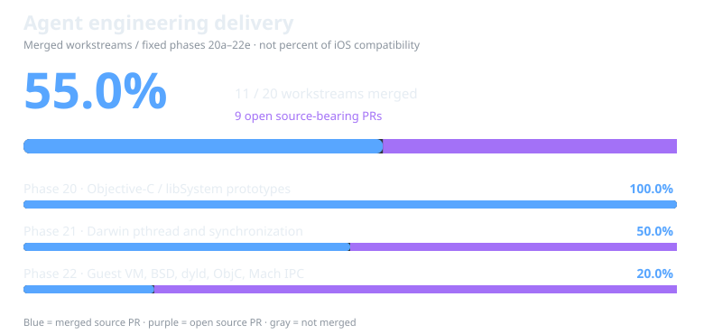
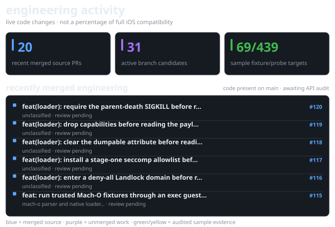
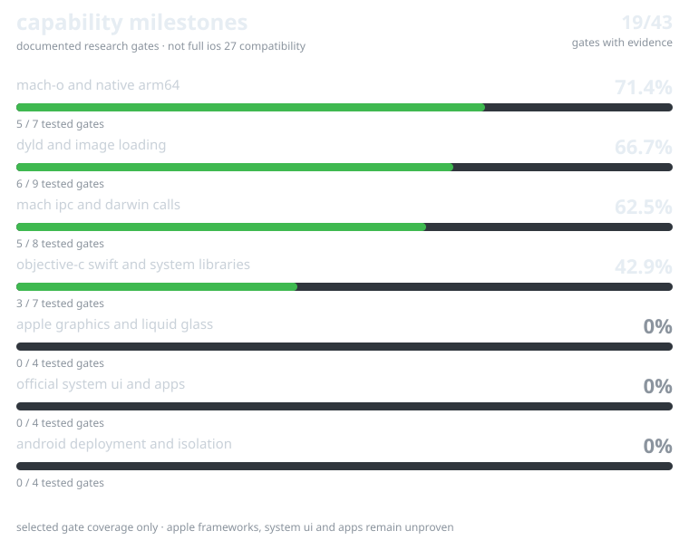

# ios-27

[capability progress and realistic ceiling](docs/PROGRESS.md) · [audited technical ceilings](docs/CEILINGS.md) · [live main/branch status](docs/repo-status.json)

## merged engineering workstreams (automatic)



<sub>This percentage counts source-bearing agent workstreams **merged into main** out of a fixed 20-workstream phase 20–22 plan. Purple means open PRs. It does **not** measure how much of real iOS works. [Evidence and per-phase details](docs/DELIVERY.md).</sub>

## recent development



<sub>the activity chart reads real merged PR source diffs and unmerged branches. these are engineering changes, not verified Apple API coverage. [source details](docs/BRANCHES.md).</sub>

## sampled compatibility blocks


[api block explorer and technical ceilings](docs/BLOCKS.md) · [live agent branch diffs](docs/BRANCHES.md) · [interactive detailed breakdown](docs/blocks.html)



**Development status:** check [verified capability progress](docs/PROGRESS.md), [live main provenance](docs/repo-status.json), and [technical ceilings](docs/CEILINGS.md). The legacy [HANDOFF.md](HANDOFF.md) may describe older phases; verify against the latest merged main.

**Target: official iOS user interface and apps running natively above Android, NOT an iOS-style launcher.** Liquid Glass/SpringBoard/Apple frameworks are not working yet. The feasibility of the complete target remains unknown.

Experimental ARM64 Darwin/iOS **userspace compatibility research** on Android/Linux, with the Samsung Galaxy S25+ as a target. This project does not install iOS, bypass Android verified boot, or alter the device boot chain.

## Device safety first

This is a **userspace-only** experiment. On modern Samsung firmware, DirtyFrag documents an Odin/download-mode **D2** restriction in some lock-screen configurations. No step here depends on DirtyFrag, root, bootloader access, a boot-chain change, or partition writes. Root is never required.

**Do not attempt a system/bootloader flash** as part of this project. Read [the safety and architecture notes](docs/architecture.md).

## Milestones

Phase 2 adds a tiny Darwin ARM64 syscall probe. It recognizes a handful of instructions and can interpret carefully constructed Mach-O fixtures that invoke getpid/getuid or virtual exit. It denies filesystem and Mach operations, has a strict instruction limit, and cannot run real iOS frameworks. This is a test harness, not an iOS 27 port.

## Phase 6: classic dyld pointer bindings

The `binds` command inventories regular classic dyld **pointer** binds in
a thin or universal ARM64 Mach-O image without modifying it:

```sh
./build/ios27 binds /path/to/arm64-macho
```

A separate library API parses classic regular dyld bind opcodes, validates
segment protection and file offsets, and resolves exports from an explicitly
provided resolver. It only applies pointer fixes to a **caller-owned in-memory
copy**, staging all writes to avoid partial updates.

On ARM64 Linux CI, a **synthetic** Mach-O consumer branches through a
resolved pointer to a **separate native ARM64 synthetic library function**,
returning 42 without CPU emulation. This does not execute an actual iOS app.

Not supported: dyld chained fixups, rebase streams, weak and lazy binding,
dyld shared caches, ARM64e pointer authentication, Mach/XNU dependencies,
UIKit, CoreAnimation, Liquid Glass or SpringBoard. The project neither reads
nor flashes Android boot partitions.

## Phase 5: dyld export trie / symbol discovery

New `symbols` support decodes the on-disk dyld export trie for thin or
universal ARM64 Mach-O files. It lists exported names and image-relative
offsets, identifies re-exports by dependent dylib ordinal, and tracks
stub/resolver exports.

```sh
./build/ios27 symbols /path/to/legitimate-unencrypted-arm64-macho
```

Decoding symbol metadata does **not** perform rebases, bind fixups, map dyld
shared caches, authenticate `arm64e` pointers, load Apple frameworks or run
official SpringBoard. Next up: native synthetic dylib image loading and
binding with executable tests, isolated from Android files.

## Phase 4: native dyld path groundwork

A new dependency-free resolver maps Apple's `@loader_path`,
`@executable_path`, and `@rpath` install-name expressions into guest-virtual
candidate paths. This is pure string processing: it never accesses host
filesystems or interprets/emulates CPU instructions.

```sh
./build/ios27 resolve-dyld '@rpath/UIKit.framework/UIKit' \
  '/Applications/Demo.app/Demo' '/Applications/Demo.app/Demo' \
  '/System/Library/Frameworks'
```

Only path resolution is implemented, not dyld loading, rebases, chained binds,
imports, exports, shared-cache mapping, code-signature validation, or actual
iOS framework execution.

## Phase 3: audit real framework dependencies

The new `audit-ios` command accepts thin ARM64 and universal FAT/FAT64
Mach-O files and lists direct dynamic-library imports such as UIKit and
private frameworks. It is read-only and runs without root. It does **not**
execute Apple binaries or make their libraries available.

```sh
./build/ios27 audit-ios /path/to/legitimately-obtained-unencrypted-Mach-O
```

The official iOS system UI needs a real dyld, Mach/XNU services, runtime
frameworks, CoreAnimation/Metal graphics bridging and SpringBoard services.
See [the official UI roadmap](docs/official-ios-ui-roadmap.md).

## First milestone

Build a native, dependency-free **Mach-O 64-bit ARM64 inspector** with strict bounds checks, then a deliberately restricted **freestanding execution proof of concept** for hand-written ARM64 test images with no iOS frameworks, dyld, system calls, or runtime dependencies.

A functioning iOS 27 SpringBoard, Apple services, App Store apps, and graphics framework are **not** implemented. Root is not needed for inspection and should not be assumed to make iOS binaries compatible.

## Build

Requires CMake 3.16+ and a C11 compiler. On Android, use an ARM64 native toolchain (such as Termux clang); on other platforms, inspection and parser tests work, but execution is ARM64-only.

```sh
cmake -S . -B build -DIOS27_BUILD_TESTS=ON
cmake --build build
ctest --test-dir build --output-on-failure
./build/ios27 inspect path/to/arm64-binary
./build/ios27 probe-darwin path/to/synthetic-test-macho
./build/ios27 audit-ios path/to/arm64-or-fat-macho
```

On Linux/Android, CMake also builds the SDK-free startup fixtures before
CTest runs. The tests use absolute fixture paths, so the build directory may
be outside the checkout and may contain spaces. For example, on Linux:

```sh
cmake -S . -B "/tmp/ios27 external build" -DCMAKE_BUILD_TYPE=Debug -DIOS27_BUILD_TESTS=ON
cmake --build "/tmp/ios27 external build" --parallel 2
ctest --test-dir "/tmp/ios27 external build" --timeout 30 --output-on-failure
```

For trusted freestanding fixtures on ARM64 Linux, `run-contained` adds a
supervised child with a one-second deadline:

```sh
./build/ios27 run-contained ./build/phase15a-executable --unsafe
```

See [contained native process execution](docs/contained-native-process.md)
for the API, syscall restrictions, outcomes, and host requirements. The
[exec guest loader](docs/exec-guest-loader.md) variant runs the same
fixtures in a fresh address space instead of a fork.

See [docs/architecture.md](docs/architecture.md) for design and limitations. Avoid running untrusted Mach-O code: execution is intended only for deliberately constructed local test fixtures. Child supervision contains faults and loops but does not provide an untrusted-code sandbox.
