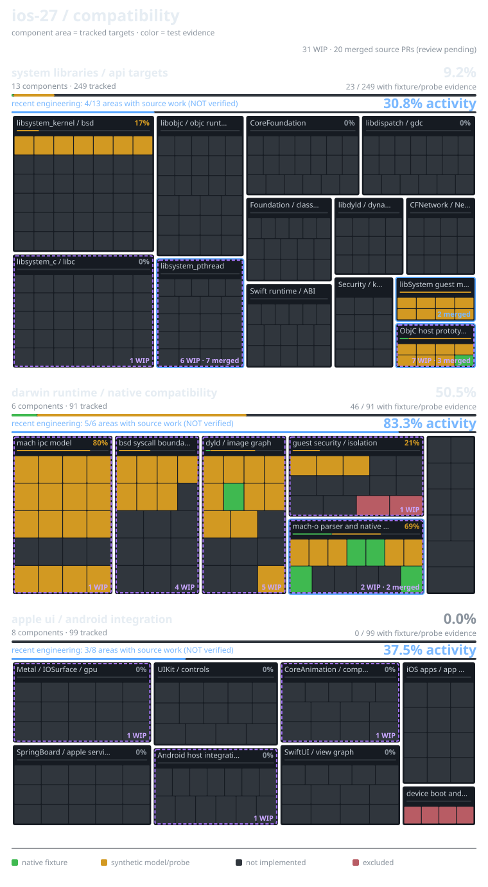

# ios-27 | live agent branch source diffs

**purple dashed = active unmerged branch; blue solid = recently merged source awaiting compatibility audit.** neither is a verified Apple ABI function or application. the verified green/amber counts remain strictly controlled by reviewed main catalogs.

candidate branches with mapped changes: **9** · audited base: `0d9edb176c31`

### [phase22d-objc-runtime-concurrency-20261028](https://github.com/kallmek3nny/ios-27/pull/84)

head: `63d7c42bae6d` · ci: **running** · unmerged, not credited.

- **unclassified**: 4 source files, 4 test/fixture files, +1285/-0 lines

### [agent/phase22c-transactional-dyld-graph](https://github.com/kallmek3nny/ios-27/pull/83)

head: `9350787f27c3` · ci: **passing_checks** · unmerged, not credited.

- **unclassified**: 2 source files, 4 test/fixture files, +865/-0 lines
  - candidate declarations: `ios27_22c_acquire`, `ios27_22c_create`, `ios27_22c_destroy`, `ios27_22c_initialize`, `ios27_22c_load`, `ios27_22c_order`, `ios27_22c_pins`, `ios27_22c_release`, `ios27_22c_resolve`, `ios27_22c_symbol`, `ios27_22c_unload`

### [phase21j-deterministic-sync-diagnostics](https://github.com/kallmek3nny/ios-27/pull/77)

head: `9e15234388e2` · ci: **passing_checks** · unmerged, not credited.

- **libsystem_pthread**: 6 source files, 27 test/fixture files, +4440/-0 lines
  - candidate declarations: `ios27_21j_acquire`, `ios27_21j_acquire_injected`, `ios27_21j_audit`, `ios27_21j_create`, `ios27_21j_destroy`, `ios27_21j_export`, `ios27_21j_lockorder_acquire`, `ios27_21j_lockorder_audit`, `ios27_21j_lockorder_cancel_wait`, `ios27_21j_lockorder_create`, `ios27_21j_lockorder_destroy`, `ios27_21j_lockorder_edge`

### [phase21f-fifo-mutex-20261028](https://github.com/kallmek3nny/ios-27/pull/78)

head: `6acea7b2995c` · ci: **passing_checks** · unmerged, not credited.

- **libsystem_pthread**: 2 source files, 20 test/fixture files, +2127/-0 lines
  - candidate declarations: `ios27_21f_mutex_create`, `ios27_21f_mutex_destroy`, `ios27_21f_mutex_info`, `ios27_21f_mutex_lock`, `ios27_21f_mutex_trylock`, `ios27_21f_mutex_unlock`, `ios27_21f_runtime_create`, `ios27_21f_runtime_destroy`, `ios27_21f_runtime_stats`

### [agent/phase21i-darwin-pthread-abi](https://github.com/kallmek3nny/ios-27/pull/80)

head: `b552d8499416` · ci: **passing_checks** · unmerged, not credited.

- **libsystem_pthread**: 6 source files, 17 test/fixture files, +2688/-0 lines
  - candidate declarations: `ios27_21i_create`, `ios27_21i_create_apple_lp64_attrs`, `ios27_21i_create_checked`, `ios27_21i_destroy`, `ios27_21i_dispatch`, `ios27_21i_dispatch_arm64`, `ios27_21i_dispatch_arm64_n`, `ios27_21i_errno_to_darwin`, `ios27_21i_get_stats`, `ios27_21i_lookup`, `ios27_21i_verify`

### [feat/phase21d-fair-rwlock-once](https://github.com/kallmek3nny/ios-27/pull/73)

head: `9ef58a1bf4cc` · ci: **passing_checks** · unmerged, not credited.

- **libsystem_pthread**: 2 source files, 12 test/fixture files, +2487/-0 lines
  - candidate declarations: `ios27_21d_create`, `ios27_21d_destroy`, `ios27_21d_once`, `ios27_21d_rdlock`, `ios27_21d_runtime_create`, `ios27_21d_runtime_destroy`, `ios27_21d_timedrdlock`, `ios27_21d_timedwrlock`, `ios27_21d_tryrdlock`, `ios27_21d_trywrlock`, `ios27_21d_unlock`, `ios27_21d_usage`
- **ObjC host prototype (not Apple libobjc)**: 0 source files, 1 test/fixture files, +47/-0 lines

### [phase21a/darwin-pthread-abi-bridge](https://github.com/kallmek3nny/ios-27/pull/69)

head: `9da58aba0436` · ci: **passing_checks** · unmerged, not credited.

- **libsystem_pthread**: 2 source files, 19 test/fixture files, +2922/-0 lines
  - candidate declarations: `ios27_21a_attach_thread`, `ios27_21a_call`, `ios27_21a_create`, `ios27_21a_create_regions`, `ios27_21a_destroy`, `ios27_21a_detach_thread`, `ios27_21a_register_once`, `ios27_21a_release_once`, `ios27_21a_validate`, `ios27_21a_validate_access`

### [phase21e-exit-cancellation-20261028](https://github.com/kallmek3nny/ios-27/pull/76)

head: `298e5e8bcf28` · ci: **passing_checks** · unmerged, not credited.

- **libsystem_pthread**: 1 source files, 5 test/fixture files, +358/-11 lines

### [phase22a-guest-address-spaces](https://github.com/kallmek3nny/ios-27/tree/phase22a-guest-address-spaces)

head: `338acee7ba2f` · ci: **not_checked** · unmerged, not credited.

- **unclassified**: 3 source files, 6 test/fixture files, +882/-0 lines
  - candidate declarations: `ios27_22a_close`, `ios27_22a_copyin`, `ios27_22a_copyout`, `ios27_22a_create`, `ios27_22a_destroy`, `ios27_22a_fail_map_after`, `ios27_22a_map`, `ios27_22a_pin`, `ios27_22a_probe`, `ios27_22a_protect`, `ios27_22a_restricted_probe`, `ios27_22a_snapshot`

## recently merged agent source changes · not yet compatibility-reviewed

recent merges appear here even after their purple WIP marker disappears. blue means merged code, **not** a newly verified iOS function.

recent merged PRs with source changes: **7**

### [merged PR #81](https://github.com/kallmek3nny/ios-27/pull/81)

merged: 2026-10-28T21:16:51Z · source changes awaiting function-level audit.

- **libsystem_pthread**: 2 source files, 3 fixtures, +872/-0 lines
  - added declarations: `ios27_21g_cond_broadcast`, `ios27_21g_cond_signal`, `ios27_21g_cond_stats`, `ios27_21g_cond_timedwait`, `ios27_21g_cond_wait`, `ios27_21g_create`, `ios27_21g_destroy`, `ios27_21g_mutex_lock`, `ios27_21g_mutex_trylock`, `ios27_21g_mutex_unlock`, `ios27_21g_runtime_create`, `ios27_21g_runtime_destroy`

### [merged PR #79](https://github.com/kallmek3nny/ios-27/pull/79)

merged: 2026-10-28T21:15:49Z · source changes awaiting function-level audit.

- **libsystem_pthread**: 2 source files, 7 fixtures, +672/-0 lines
  - added declarations: `ios27_21h_get_stats`, `ios27_21h_lock`, `ios27_21h_object_close`, `ios27_21h_object_create`, `ios27_21h_object_destroy`, `ios27_21h_runtime_create`, `ios27_21h_runtime_destroy`, `ios27_21h_trylock`, `ios27_21h_unlock`

### [merged PR #75](https://github.com/kallmek3nny/ios-27/pull/75)

merged: 2026-10-28T20:14:11Z · source changes awaiting function-level audit.

- **libsystem_pthread**: 2 source files, 7 fixtures, +452/-15 lines

### [merged PR #74](https://github.com/kallmek3nny/ios-27/pull/74)

merged: 2026-10-28T20:05:34Z · source changes awaiting function-level audit.

- **libsystem_pthread**: 2 source files, 6 fixtures, +405/-22 lines

### [merged PR #70](https://github.com/kallmek3nny/ios-27/pull/70)

merged: 2026-10-28T19:59:38Z · source changes awaiting function-level audit.

- **libsystem_pthread**: 2 source files, 6 fixtures, +1004/-0 lines
  - added declarations: `ios27_21c_cond_broadcast`, `ios27_21c_cond_signal`, `ios27_21c_cond_timedwait`, `ios27_21c_cond_wait`, `ios27_21c_mutex_lock`, `ios27_21c_mutex_trylock`, `ios27_21c_mutex_unlock`, `ios27_21c_runtime_create`, `ios27_21c_runtime_destroy`, `ios27_21c_sync_create`, `ios27_21c_sync_destroy`, `ios27_21c_usage`

### [merged PR #72](https://github.com/kallmek3nny/ios-27/pull/72)

merged: 2026-10-28T19:56:54Z · source changes awaiting function-level audit.

- **libsystem_pthread**: 2 source files, 4 fixtures, +975/-0 lines
  - added declarations: `ios27_21e_attach`, `ios27_21e_cancel_checkpoint`, `ios27_21e_cancel_register`, `ios27_21e_cancel_request`, `ios27_21e_cancel_setstate`, `ios27_21e_cancel_unregister`, `ios27_21e_cleanup_pop`, `ios27_21e_cleanup_push`, `ios27_21e_cleanup_unwind`, `ios27_21e_create`, `ios27_21e_destroy`, `ios27_21e_getspecific`

### [merged PR #71](https://github.com/kallmek3nny/ios-27/pull/71)

merged: 2026-10-28T19:54:07Z · source changes awaiting function-level audit.

- **libsystem_pthread**: 2 source files, 3 fixtures, +774/-0 lines
  - added declarations: `ios27_21b_attr_init`, `ios27_21b_attr_validate`, `ios27_21b_runtime_create`, `ios27_21b_runtime_destroy`, `ios27_21b_runtime_usage`, `ios27_21b_runtime_wait_idle`, `ios27_21b_thread_create`, `ios27_21b_thread_detach`, `ios27_21b_thread_equal`, `ios27_21b_thread_info`, `ios27_21b_thread_join`, `ios27_21b_thread_self`

## verification policy

changed paths and added declarations are parsed from GitHub PR file patches or main-vs-branch diffs, not commit messages. CI status is a hint only. staged branches may fail integration, omit needed tests, or duplicate already merged work. only separately reviewed catalog updates from merged main can change confirmed target statuses.

Refresh: `timeout 150s python3 tools/scan_branch_activity.py`, then `timeout 15s node tools/compat_blocks.cjs`. a scheduled workflow checks for new agent work at least every 15 minutes, subject to GitHub Actions scheduling delays.

